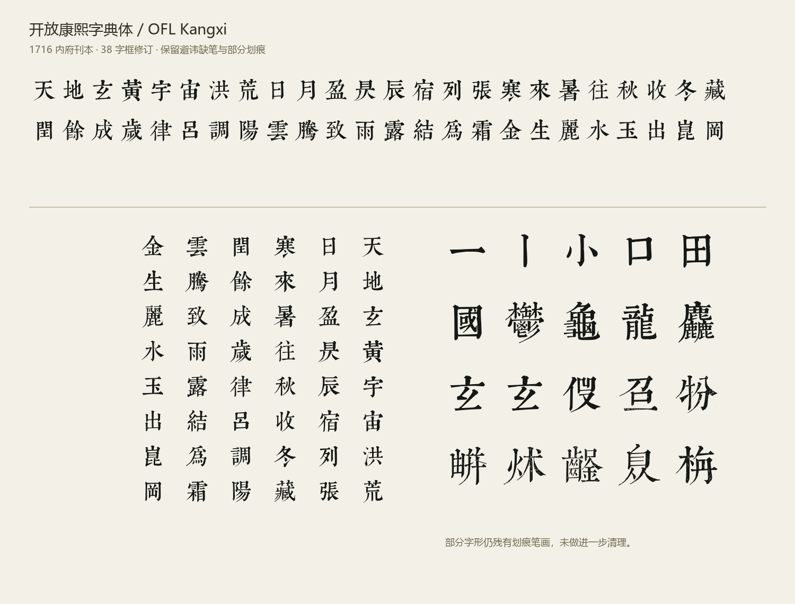

# 开放康熙字典体 / OFL Kangxi

清康熙五十五年（1716）内府刊本《康熙字典》的扫描字头字体。
目标是保留原刻轮廓，提供免费、可修改、可再分发的字体及完整切分和构建算法。

当前为 **0.100 首发校勘版**。原始资料有 47,043 条字头记录，46,960 个独立字头，83 张重复字头和 539 张部首标题。独立字头全部进入字体；重复出处和部首标题保存在源码档案中，不冒充额外 Unicode 字符。

## 下载与使用

字体和大体积源档案在 [v0.100 Release](https://github.com/fangquinlan/kangxi-1716/releases/tag/v0.100) 下载。克隆后运行 python scripts/fetch_assets.py 取得字体、原PNG与校勘页图片；加 --all 同时取得SVG及逐字测量。所有下载均按 assets.json 校验 SHA-256。

- 安装字体：fonts/OFLKangxi-Regular.otf
- 网页字体：fonts/OFLKangxi-Regular.woff2
- 横竖排样张：proof/index.html
- 本轮校对条目：proof/review.html，可搜索、分组、记录与导出校勘结果。
- 全部原 PNG：sources/glyphs-original.zip
- 字体字框中的 SVG：sources/glyphs.svg.zip（每个字以 Unicode 命名；完整档案在 GitHub Release 提供，构建亦会生成）
- 来源和页面坐标：sources/manifest.json；逐字测量与变换：reports/glyph-metrics.json。

本地校勘：`python scripts/serve_review.py --pdf-root 原PDF目录`，然后打开 `http://127.0.0.1:8766/proof/review.html`。Windows 可双击 `review.cmd`（已安装 Python 及依赖时）。

点击“重新拉字框”，在原页拖动矩形 → 预览净字 → 保存。阈值可手动调整；保存后刷新仍能看到修订。`sources/overrides/` 保存坐标、哈希、净字 PNG 和修订历史，原始档案不变。重新运行构建后字体采用修订；撤销后恢复原始输入。重复出处的修订以字符为目标，同一字符最后保存的修订生效。

保持等宽 1000 UPM，横排和竖排均有度量。没有复制商业康熙字体轮廓，没有现代字体补字。默认不补齐避讳、残损或小孔，不将原刻异体改成现代规范字。
原始主字图中的缺笔玄标为 U+248E5「𤣥」，U+7384「玄」通过显式别名映射使用同一轮廓；这是便于日常输入的编辑决定，不宣称两码在 Unicode 中规范等价。
本项目主要提供汉字，未重新设计西文和标点；排版软件可能回退到其他字体。

## 构建验证

46,960 个字全部通过 32px 栅格化和实际轮廓边界检查；24 个重点字通过 16、24、32、48、96、256px 检查。HarfBuzz 横排 advance=(1000,0)、竖排 advance=(0,-1000)。WOFF2 与 OTF 的字体表逐项一致（head 校验调整项除外）。OTF 53.98 MB，WOFF2 37.38 MB。

源分辨率描摹 IoU 中位数约0.960，最低约0.932；14字低于0.94，明细见 reports/validation.json，对照见 proof/trace-outliers.png。此误差阈值用于披露，不代表字义错误或已经逐笔修复。

## 重建字体

1. Python 3.11+，安装 requirements.txt。
2. 安装 Potrace 1.16 库；必要时设置 POTRACE_LIBRARY 为 libpotrace 的路径。
3. python scripts/fetch_assets.py，然后 python scripts/build.py --workers 8
4. python scripts/validate.py

构建自动展开原始 PNG，逐字描摹、误差检查、尺寸校准、光学定位、编译 OTF/WOFF2。逐字哈希缓存仅存于 build/，不加入版本库；只重描发生改变的字图。排版变换和字体表仍全量重建。要重算，移除 build/traces.sqlite3 即可。

重做扫描切分需要另行取得原 PDF、参考识别字体和页面字头表，见 segmentation/README.md。字体重建不需要参考识别字体，也不需下载整部 PDF。

## 许可与来源

- 字体、字形 SVG、字形数据库中的新贡献：SIL Open Font License 1.1，见 OFL.txt。不声明 Reserved Font Names。
- 切分、追踪接口、归一化、构建、验证代码与预览工具：MIT，见 LICENSE-CODE。
- 原书及公版数字复制件的既有公有领域地位不因本项目改变。
- Potrace 作为外部工具有自己的 GPL 许可；本项目不打包其二进制。
- 书格及哈佛的文字介绍、网站内容和标识不纳入本项目许可。

原书由张玉书、陈廷敬等编纂，哈佛大学图书馆藏本，书格提供整理及下载。
出处：[书格](https://www.shuge.org/view/kang_xi_zi_dian/)、[哈佛目录](https://id.lib.harvard.edu/alma/990032703120203941/catalog)。来源机构未参与本项目或为本项目背书。
详见 docs/PROVENANCE.md、docs/ALGORITHM.md、reports/build-report.json 和 reports/validation.json。

本轮人工校对已完成（2026-11-08，用户确认），涵盖整理出的 1,170 条复核记录，已保存 38 个字符的重拉框修订。**部分字形仍残有划痕笔画，未做进一步清理。** 本轮针对标记条目的校对，不宣称对全部 46,960 个字进行逐字人工审查。原书残损、异体和避讳缺笔仍予保留。
